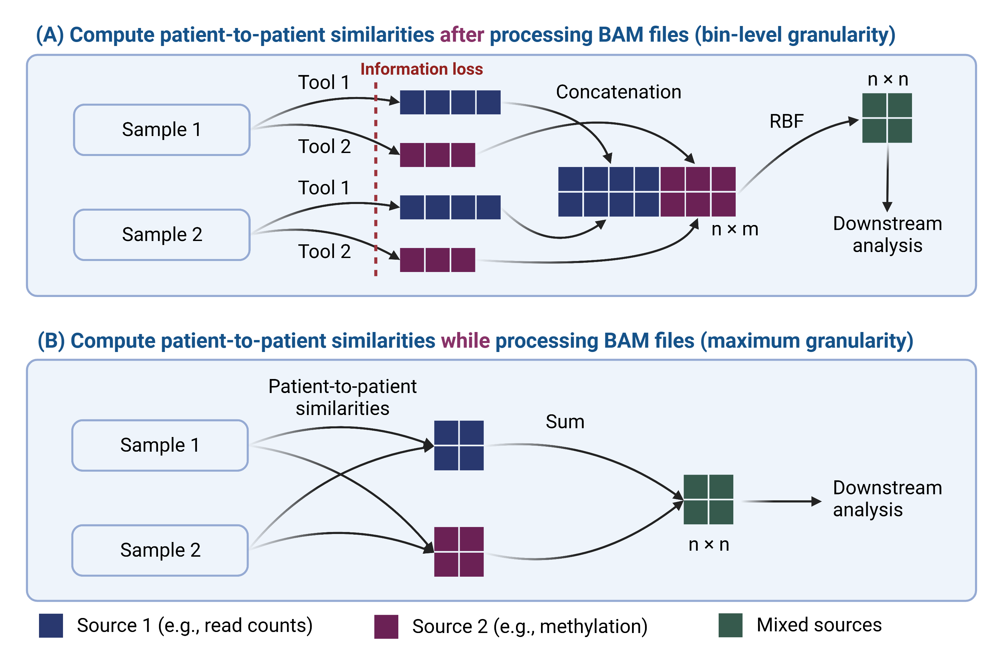
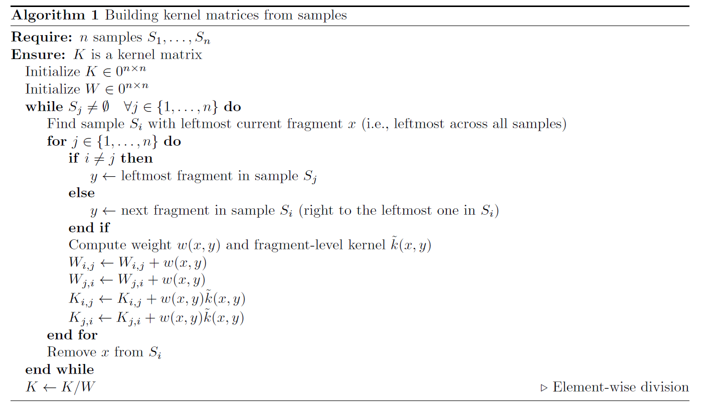

Kernel methods
==============

Why "fragment-level" kernels?
"""""""""""""""""""""""""""""

Illustrative summary of the motivation for designing our novel multimodal analysis framework. (A) Flowchart of a typical analytical pipeline. We hypothesize that external tools or in-house feature extraction methods introduce information bottlenecks which affect the reliability of downstream analysis. (B) Our proposed simplified pipeline, where kernel matrices (i.e., patient-to-patient similarities) are constructed from the raw sequencing data directly. Since kernel functions are comparing sequencing reads/fragments directly, they enable maximum degree of granularity for downstream analysis.

The main idea
"""""""""""""

We denote each sample as a set of fragments :math:`S = \{x_1, \dotsc, x_p\}` ordered by genomic coordinates, where :math:`x_k` is the k-th fragment in :math:`S`. We aim at measuring the genomic and epigenomic similarities between any two samples :math:`S_a` and :math:`S_b`. Since sequencing data are variable in size, we tackle this challenge by expressing sample-wise similarity as a weighted linear combination of fragment-wise similarities:

.. math::

    k(S_a, S_b) = \sum_{x_1 \in S_a} \sum_{x_2 \in S_b} w(x_1, x_2) \tilde{k}(x_1, x_2),

where the weights are normalized such that :math:`\sum_{x_1 \in S_a} \sum_{x_2 \in S_b} w(x_1, x_2) = 1`.

In principle, modelling the sample-to-sample differences at the fragment-level enables the highest degree of granularity for downstream analysis. However in practice, not all fragments are comparable due to either their genomic distance (e.g., fragments spanning different CpG sites) or their difference in GC-content (i.e., reads are preferentially PCR-amplified or sequenced based on GC-content). Therefore, we re-weight the contribution of :math:`\tilde{k}(x_1, x_2)` based on the distance between :math:`x_1` and :math:`x_2`, and their difference in GC-content. Let :math:`c(x), p(x), g(x)` be the chromosome, start position (in bp) and GC-content of fragment :math:`x`, respectively. For most of our kernel functions, we define weights as

.. math::

    w(x_1, x_2) =
        \begin{cases}
        0, & \mbox{if } c(x_1) \neq c(x_2), \\
        0, & \mbox{if } \vert p(x_1) - p(x_2) \vert > 300, \\
        1 - \vert g(x_1) - g(x_2) \vert, & \mbox{otherwise}.
        \end{cases}

In order to keep the complexity of our algorithm linear with respect to the total number of fragments (and linear in the number of samples), we do not consider all fragment pairs, but only the :math:`(x, y)` pairs evaluated by the algorithm below. This algorithm builds a matrix :math:`K \in \mathbb{R}^{n \times n}`, where `n` is the total number of samples, by iterating over the fragments of all samples simultaneously and at the same pace.

