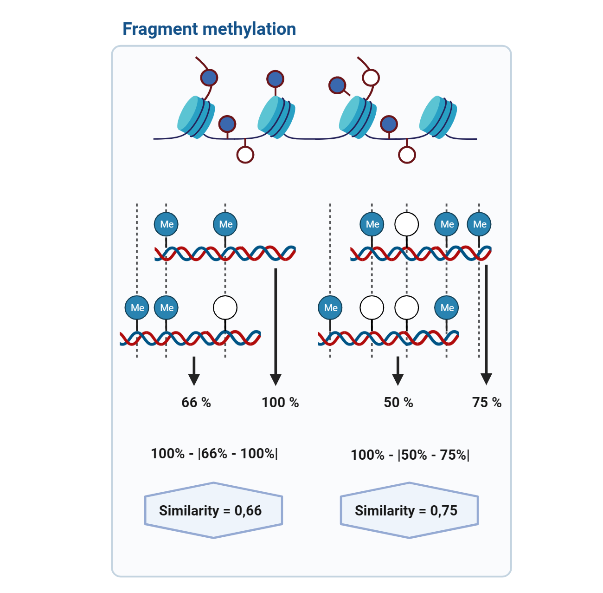
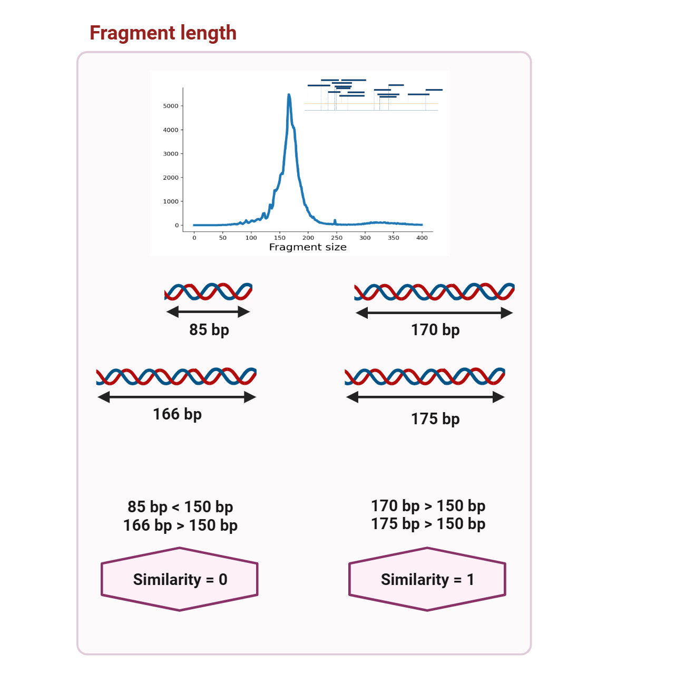
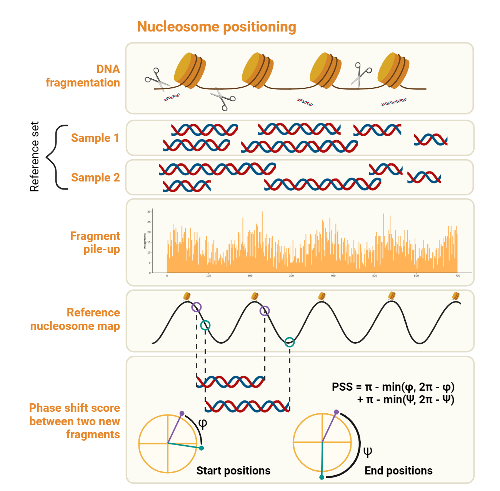
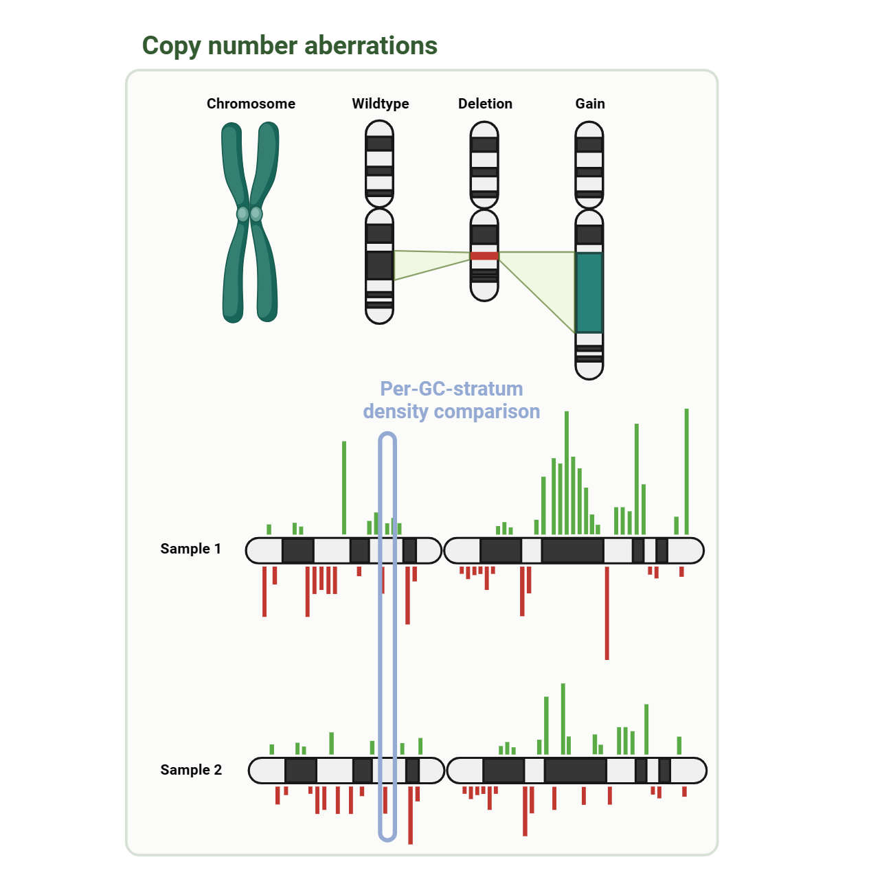
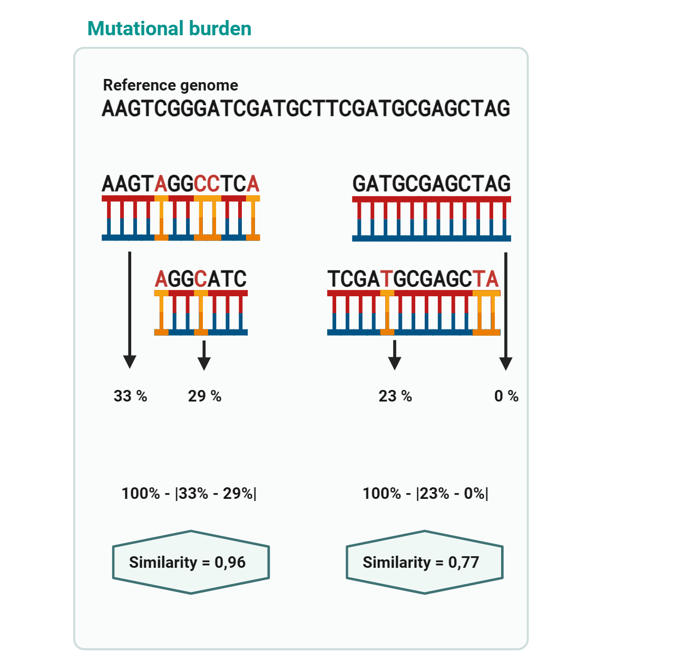

Genomic and epigenomic kernels
==============================

Epigenomic kernels
""""""""""""""""""

Methylation
-----------

Fragment lengths
----------------

Nucleosome positioning
----------------------

Genomic kernels
"""""""""""""""

Copy number aberrations
-----------------------

Mutational burden
-----------------

